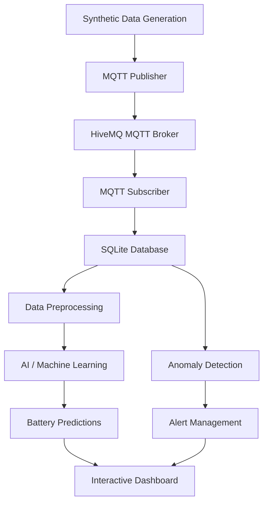

# AI-Based EV Battery State-of-Health Estimation

### An AI-powered battery intelligence, predictive maintenance, and real-time monitoring system for electric vehicles.

**Live Project Website:** [AI-Based EV Battery SoH Estimation](https://anshikach2006.github.io/AI-Based-SOH-Estimation-Of-EV-Battery/)

**GitHub Repository:** [AI-Based-SOH-Estimation-Of-EV-Battery](https://github.com/anshikach2006/AI-Based-SOH-Estimation-Of-EV-Battery)

---

## Project Overview

Electric vehicle batteries gradually lose their capacity and performance with repeated charging and discharging cycles. Monitoring battery health is essential for improving reliability, identifying potential faults, and planning maintenance.

**AI-Based EV Battery State-of-Health Estimation** is a battery intelligence system designed to monitor battery parameters, estimate battery health, predict degradation, and identify abnormal operating conditions using machine learning and real-time data processing.

The project integrates electrical engineering, artificial intelligence, machine learning, IoT communication, database management, and interactive visualization into a unified EV battery monitoring solution.

The system follows a data pipeline that collects battery readings, transmits them through MQTT, stores telemetry in an SQLite database, processes the data using machine learning models, and presents battery insights through a monitoring dashboard.

## Project Objectives

- Estimate the State of Health (SoH) of EV batteries.
- Monitor State of Charge (SoC) and electrical operating parameters.
- Analyze battery degradation across charge-discharge cycles.
- Estimate Remaining Useful Life (RUL) in terms of remaining cycles.
- Detect abnormal conditions such as overcurrent, overvoltage, and overheating.
- Enable real-time battery telemetry monitoring through MQTT.
- Store battery readings, predictions, and alerts for historical analysis.
- Visualize battery performance through an interactive dashboard.
- Explore battery condition using a 3D battery visualization.

## Key Features

### 1. Battery State-of-Health Estimation

SoH indicates the remaining capacity of a battery relative to its original capacity.

The basic capacity-based formula is:

\[
SoH(\%) = \frac{\text{Current Available Capacity}}{\text{Original Rated Capacity}} \times 100
\]

The project uses battery operating parameters and machine learning to estimate battery health and analyze degradation over time.

### 2. State-of-Charge Monitoring

SoC represents the estimated percentage of charge remaining in a battery.

The system monitors SoC alongside voltage, current, temperature, and cycle information to provide a more complete picture of battery operation.

### 3. Battery Degradation Analysis

Battery health can decline with repeated usage. Analyzing cycle-related trends helps identify degradation patterns and understand changes in battery performance.

The project uses historical battery data and machine learning predictions to support battery degradation analysis.

### 4. Remaining Useful Life Prediction

Remaining Useful Life estimates how many additional charge-discharge cycles a battery may complete before reaching a defined end-of-life threshold.

The estimation depends on the observed or predicted degradation trend and the selected threshold. RUL is an estimate, not a guarantee of the battery's actual remaining life.

### 5. Anomaly Detection

The system is designed to identify abnormal battery operating conditions and support early fault identification.

| Anomaly | Description |
|---|---|
| Overvoltage | Voltage exceeds the configured operating limit. |
| Undervoltage | Voltage falls below the configured operating limit. |
| Overcurrent | Current exceeds the configured current limit. |
| Overtemperature | Battery temperature exceeds the configured thermal limit. |
| Low SoH | Estimated battery health falls below the configured threshold. |
| Abnormal readings | Measurements violate configured operating rules or plausibility checks. |

Detected conditions can be associated with a severity level, timestamp, and explanatory message.

Detection depends on the implemented rules, configured thresholds, and available input data. The system is a monitoring prototype, not a certified battery safety controller.

### 6. Real-Time Data Communication

MQTT provides lightweight messaging between the battery data publisher and subscriber.

The publisher sends battery readings, while the subscriber receives messages for subsequent database storage and processing.

This architecture supports streaming-style monitoring without requiring the dashboard to read directly from the original CSV file.

### 7. Historical Data Storage

SQLite provides local storage for battery telemetry and, where implemented, model predictions and alerts.

Historical records support trend analysis, debugging, model evaluation, and comparisons across battery identifiers.

### 8. Interactive Battery Dashboard

The dashboard is designed to bring battery information together in one interface, including:

- Battery health and charge indicators.
- Voltage, current, and temperature readings.
- Cycle and degradation trends.
- Machine learning predictions and model comparisons.
- Battery fault and alert information.
- Battery selection and historical analysis.
- A 3D battery visualization.

The live monitoring pipeline and dashboard should be run locally when using the complete Python application. The GitHub Pages website serves as the project's web-based presentation.

## System Architecture

The project follows this processing sequence:



### How the System Works

**1. Synthetic Data Generation**

Battery telemetry is generated or prepared with parameters such as voltage, current, temperature, SoC, cycle count, capacity, and SoH. Simulated abnormal readings can be included to test fault detection.

**2. MQTT Publisher**

The publisher sends battery readings as MQTT messages. CSV replay can be used to publish historical records sequentially as a simulated telemetry stream.

**3. HiveMQ Broker**

HiveMQ receives published messages and routes them to subscribers that have subscribed to the relevant topics.

**4. MQTT Subscriber**

The subscriber receives telemetry messages and prepares the data for storage.

**5. SQLite Database**

The readings are stored locally to maintain a historical record of battery operation.

**6. AI/ML Processing**

The machine learning pipeline processes battery features to estimate SoH and analyze degradation. Additional predictions depend on the trained models and implemented inference logic.

**7. Dashboard**

The dashboard presents battery measurements, predictions, historical trends, model comparisons, and anomaly information.

**8. Alert Management**

Configured rules identify abnormal conditions and generate alerts for display in the dashboard.

## Machine Learning Approach

The project explores supervised machine learning models for battery health estimation.

### Models

| Model | Approach | Purpose |
|---|---|---|
| Linear Regression | Linear statistical model | Establishes a baseline for battery health estimation. |
| Random Forest Regressor | Ensemble of decision trees | Models nonlinear relationships between battery features and SoH. |
| Gradient Boosting Regressor | Sequential boosting ensemble | Learns patterns by progressively correcting prediction errors. |

The models can be compared to understand which approach performs better on the selected dataset.

### Input Features

Depending on the dataset and preprocessing implementation, potential features include:

- Battery cycle count.
- Mean, minimum, and maximum voltage.
- Mean current.
- Mean and maximum temperature.
- Discharge duration.
- Battery identifier and other available telemetry fields.

### Prediction Target

The primary prediction target is:

`SoH`

The exact input features depend on the trained model and the columns available in the dataset.

### Model Evaluation

The following metrics can be used to evaluate regression performance.

**Mean Absolute Error (MAE)**

Measures the average absolute difference between actual and predicted values.

**Root Mean Squared Error (RMSE)**

Measures prediction error while giving greater weight to larger errors.

**Coefficient of Determination (R²)**

Measures how well the model explains the variation in the target values.

Model performance should be reported using the actual evaluation results obtained from the training and test datasets.

## Project Data

Battery data is used to train, test, and demonstrate the monitoring pipeline.

Depending on the configured workflow, the data may include:

| Field | Description |
|---|---|
| `timestamp` | Time associated with a battery reading. |
| `battery_id` | Identifier for a battery. |
| `voltage` | Measured or simulated battery voltage. |
| `current` | Measured or simulated battery current. |
| `temperature` | Battery operating temperature. |
| `SoC` | State of Charge. |
| `cycle` | Charge-discharge cycle count. |
| `capacity` | Available or measured battery capacity. |
| `SoH` | State of Health. |

Column names may vary between the original dataset, generated data, and database schema.

### Dataset Considerations

- Synthetic data can be used to test the complete data pipeline and demonstrate anomaly handling.
- Historical battery datasets can be used for degradation analysis and model training.
- Training and evaluation data should be separated appropriately.
- Synthetic predictions should not be presented as validated real-world battery performance.

## Technology Stack

| Technology | Role |
|---|---|
| Python | Core programming language. |
| Pandas | Data loading, preprocessing, and manipulation. |
| NumPy | Numerical computations. |
| Scikit-learn | Machine learning and model evaluation. |
| MQTT | Lightweight telemetry messaging. |
| HiveMQ | MQTT message broker. |
| SQLite | Local database for battery records. |
| Streamlit | Interactive dashboard framework, if used by the application. |
| Plotly / Matplotlib | Data visualization, depending on the implemented charts. |
| Git and GitHub | Version control and project hosting. |
| GitHub Pages | Hosting the project website. |

## Getting Started

Follow these instructions to prepare the Python application on your local machine.

### Prerequisites

Install the following:

- Python 3.10 or another version compatible with your dependencies.
- pip.
- Git.
- Docker, if your HiveMQ broker is configured to run in a Docker container.

### 1. Clone the Repository

Open Command Prompt or a terminal and run:

```bash
git clone https://github.com/anshikach2006/AI-Based-SOH-Estimation-Of-EV-Battery.git
```

Navigate into the repository:

```bash
cd AI-Based-SOH-Estimation-Of-EV-Battery
```

### 2. Create a Virtual Environment

```bash
python -m venv venv
```

Activate it on Windows:

```bash
venv\Scripts\activate
```

### 3. Install Dependencies

If the repository contains a `requirements.txt` file, install the listed dependencies:

```bash
pip install -r requirements.txt
```

If the repository does not contain this file, install the dependencies listed in the actual project configuration.

### 4. Configure the MQTT Broker

Configure the publisher and subscriber to use the same MQTT broker address, port, and topic.

For a local HiveMQ broker, the connection settings depend on the HiveMQ configuration.

Typical MQTT settings are:

| Setting | Example |
|---|---|
| Broker host | `localhost` |
| MQTT port | `1883` |
| Telemetry topic | `ev/battery/B001/telemetry` |
| Alert topic | `ev/battery/B001/alert` |

These are example settings. Use the values configured in your code and broker.

Ensure the broker is running and accessible before starting the publisher and subscriber.

### 5. Start the Data Pipeline

The general execution sequence is:

1. Start the MQTT broker.
2. Open a terminal and run the subscriber.
3. Open another terminal and run the publisher.
4. Confirm that the subscriber is receiving battery messages.
5. Verify that incoming records are being stored in SQLite.
6. Start the machine learning prediction and dashboard components as required by the implementation.

If your scripts are named `subscriber.py` and `publisher.py`, run the following commands from the directory containing the scripts.

Start the subscriber:

```bash
python subscriber.py
```

In a separate terminal, start the publisher:

```bash
python publisher.py
```

### 6. Launch the Dashboard

If the application uses Streamlit and the dashboard entry point is named `dashboard.py`, run:

```bash
streamlit run dashboard.py
```

Streamlit normally opens the local application at:

`http://localhost:8501`

If your dashboard entry point has a different filename, substitute the actual filename.

**Important:** GitHub Pages hosts static web content. It does not run your local Python subscriber, SQLite database, MQTT broker, or Streamlit application. Those components must run in an appropriate local or server environment.

## Expected Outcomes

The system is designed to demonstrate how multiple technologies can work together to support EV battery monitoring.

Expected outcomes include:

- Battery telemetry flowing through an MQTT-based communication pipeline.
- Local storage of incoming battery measurements.
- Machine learning-based SoH estimation.
- Analysis of battery degradation trends.
- Comparison of regression model performance.
- Configurable detection of abnormal battery conditions.
- An interactive interface for exploring battery status and predictions.
- A foundation for future battery predictive-maintenance applications.

Actual accuracy, response time, and fault-detection performance must be established through testing.

## Limitations

- Model accuracy depends on dataset quality, feature selection, and training methodology.
- Synthetic data cannot fully reproduce the complexity of real EV battery operation.
- SoH and RUL predictions are estimates and can be affected by temperature, usage patterns, battery chemistry, and aging.
- Configured anomaly thresholds may not be suitable for every battery chemistry or battery pack.
- MQTT and database reliability depend on the deployment configuration.
- A monitoring prototype should not replace a certified Battery Management System or independent safety protections.

## Future Enhancements

Potential improvements include:

- Integrating additional real-world EV battery datasets.
- Evaluating advanced models such as XGBoost and time-series neural networks.
- Improving Remaining Useful Life prediction with better degradation models.
- Implementing adaptive anomaly detection.
- Adding battery-level comparisons and fleet monitoring.
- Enhancing the live 3D battery visualization.
- Improving alert history, filtering, and notifications.
- Adding model explainability and feature importance.
- Deploying the Python application to a cloud environment.
- Evaluating model performance under different operating conditions.

## Project Significance

This project combines **Electrical Engineering, Artificial Intelligence, Machine Learning, and IoT** to explore predictive maintenance for electric vehicle batteries.

It demonstrates how battery telemetry can be collected, communicated, stored, analyzed, and visualized in a unified system.

The project also provides a practical foundation for learning about battery degradation, regression modeling, real-time messaging, anomaly detection, and data-driven battery management.

## Author

**Anshika Choudhary**

B.Tech — Electrical and Computer Engineering

### Project Links

- **Live Website:** [AI-Based EV Battery SoH Estimation](https://anshikach2006.github.io/AI-Based-SOH-Estimation-Of-EV-Battery/)
- **GitHub Repository:** [AI-Based-SOH-Estimation-Of-EV-Battery](https://github.com/anshikach2006/AI-Based-SOH-Estimation-Of-EV-Battery)

## License

A license has not been specified in this README. Add an appropriate open-source license to the repository if you intend to permit others to use, modify, or distribute the project.

---

## Author

**Anshika Choudhary**  
B.Tech in Electrical and Computer Engineering
---
